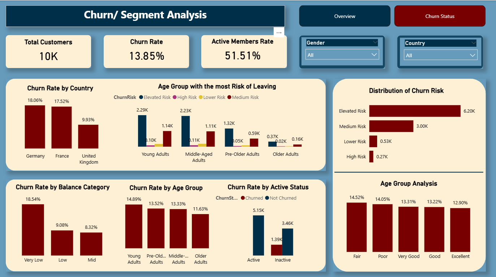

# Veritas Bank Customer Churn Analysis
Author: Okojie Kelvin Echiejile 

A comprehensive customer churn analysis project designed to identify the key drivers of attrition at Veritas Bank and uncover actionable retention opportunities.

This project leverages customer demographic, financial, behavioural, and tenure data to explore churn patterns, identify high-risk customer segments, and provide data-driven recommendations for improving customer retention and long-term profitability.

# Project Overview
The analysis investigates customer attrition trends using a bank customer dataset containing demographic profiles, account balances, credit scores, activity status, product usage, tenure, and churn outcomes.

Through exploratory data analysis (EDA), the project identifies customer groups with elevated churn risk and highlights the underlying factors influencing customer departures.

# What This Project Covers
Data cleaning and preparation,
Customer churn pattern analysis,
Demographic segmentation (Age, Gender, Geography),
Balance and financial behaviour analysis,
Customer tenure and loyalty assessment,
Activity and engagement analysis,
Identification of high-risk customer segments,
Business impact assessment of churn,
Data-driven customer retention recommendations,
Interactive Power BI dashboard development,
SQL-based data exploration and analysis.

# Business Problem

Customer churn remains one of the biggest challenges for retail banks. While individual customer departures may appear insignificant, cumulative losses can significantly impact business growth and profitability.

For Veritas Bank, rising churn rates raised concerns around:

Loss of high-value customers,
Declining customer lifetime value,
Increased customer acquisition costs,
Reduced cross-selling opportunities,
Potential service and engagement gaps.

This analysis aimed to identify the factors driving customer churn and develop strategies to improve customer retention.

# Dataset Information

Dataset: customer_churn.csv

| Column              | Description                                      |
|---------------------|--------------------------------------------------|
| Customer ID         | Unique customer identifier                       |
| Age	                | Customer age                                     |
| Gender              | Customer gender                                  |
| Geography	          | Customer location                                |
| Credit Score	      | Customer credit rating                           |
| Balance	            | Account balance                                  |
| Tenure	            | Years with the bank                              |
| NumOfProducts	      | Number of banking products held                  |
| IsActiveMember	    | Customer activity status                         |
| Exited	            | Customer churn status (1 = Churned, 0 = Retained)|

The dataset combines customer demographics, financial information, behavioural indicators, and relationship metrics to support churn analysis.

# Analysis Approach

The project follows a structured analytical workflow:

# Data Preparation
Reviewed dataset structure and quality
Cleaned and validated customer records
Prepared variables for analysis

# Exploratory Data Analysis
Examined churn distribution across customer groups
Analysed customer behaviour and account characteristics
Identified patterns associated with customer exits

# Customer Segmentation
Analysed churn rates by age groups
Investigated the impact of account balances
Explored tenure-related retention patterns
Assessed customer activity and engagement levels

# Business Insights Development
Identified high-risk customer profiles
Evaluated business impact
Generated actionable retention recommendations

# Key Findings from the Analysis
1. Age & Churn Behaviour
Customers aged **35–55** have the **highest churn rate at ~32%**, which is **1.6x higher** than customers under 30.
Younger customers demonstrated stronger customer retention.
Customer age emerged as a significant churn predictor.

2. Balance & Churn Risk
Customers with high account balances had a higher churn risk.
Large deposits did not necessarily translate to loyalty.
High-value customers may leave despite contributing substantial revenue.

3. Tenure & Customer Loyalty
Customers early in their banking relationship showed the highest likelihood of churn.
Retention rates improved significantly as customer tenure increased.
Weak onboarding experiences may contribute to early customer exits.

4. Customer Activity
Inactive customers were considerably more likely to churn.
Reduced engagement served as an early warning indicator of potential attrition.
Active customers demonstrated stronger long-term loyalty.
Business Impact

# Customer churn can negatively affect organisational performance through:

Direct revenue loss,
Deposit withdrawals and declining asset value,
Increased customer acquisition expenses,
Reduced customer lifetime value (CLV),
Lower cross-selling and upselling opportunities,
Decreased long-term profitability.

# Recommendations

Based on the analysis findings, the following business recommendations are proposed:

1. Retain High-Value Customers
Introduce loyalty and rewards programmes for customers with substantial balances.
Develop exclusive incentives for premium account holders.

2. Strengthen Customer Onboarding
Implement structured onboarding journeys.
Increase engagement during the first year of the customer lifecycle.

3. Improve Customer Engagement
Deploy personalised marketing and product recommendations.
Develop targeted campaigns for inactive customers.

4. Predict and Prevent Churn
Implement predictive churn models.
Monitor customer behaviour in real time.
Trigger proactive retention interventions before customers disengage.

# Tools & Technologies
SQL – Data querying, cleaning, and analysis,
Power BI – Dashboard development and data visualisation,
Excel – Data validation and preliminary analysis,
Data Analytics – Customer segmentation and churn analysis.

## 📊 Dashboard Preview

*Overview dashboard showing key churn metrics*

*Breakdown of churn risk across different customer groups*

# Business Value

This analysis demonstrates how customer demographics, account balances, engagement levels, and tenure influence customer retention.

By identifying high-risk customer segments and implementing targeted retention strategies, Veritas Bank can reduce customer attrition, improve customer satisfaction, and strengthen long-term profitability.

# Author

Okojie Kelvin Echiejile

Data Analyst | Business Intelligence Analyst | SQL | Power BI | Data Storytelling

Data Analyst | Power BI • SQL • Python 
Manchester, UK
