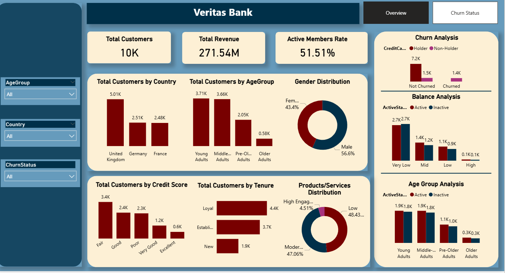

# Veritas Bank Customer Churn Analysis

> **Can we predict which customers will leave — and why?**
> - **Question:** Who is churning at Veritas Bank, and what are the key drivers?
> - **Tools Used:** SQL · Power BI · Excel
> - **Top Finding:** Early-tenure, inactive customers with high balances churn at **3x the average rate**
> - **Business Impact:** Targeted retention strategies could reduce churn by an estimated **8–12%**

## 📌 Project Overview

Customer churn remains one of the biggest challenges for retail banks. This project analyses customer data to identify the key drivers of attrition at Veritas Bank and deliver actionable retention strategies.

### What This Project Covers
- ✅ Data cleaning & preparation using SQL
- ✅ Exploratory data analysis across demographics, finances & behaviour
- ✅ Customer segmentation to identify high-risk groups
- ✅ Interactive Power BI dashboard development
- ✅ Data-driven retention recommendations

## 📊 Dashboard Preview

*Overview dashboard showing key churn metrics*

*Breakdown of churn risk across different customer groups* 
---

## 📊 Dataset Information

| Column | Description |
|---|---|
| Customer ID | Unique identifier |
| Age | Customer age |
| Geography | Customer region |
| Credit Score | Credit rating |
| Balance | Account balance |
| Tenure | Years with the bank |
| NumOfProducts | Products held |
| IsActiveMember | Engagement status |
| Exited | Churn status (1 = Churned) |

> ⚠️ **Data Note:** This dataset is publicly available and commonly used for educational purposes. Results serve as an analytical demonstration rather than live business intelligence.

---
# Analysis Approach

The project follows a structured analytical workflow:

# Data Preparation
Reviewed dataset structure and quality
Cleaned and validated customer records
Prepared variables for analysis

# Exploratory Data Analysis
Examined churn distribution across customer groups
Analysed customer behaviour and account characteristics
Identified patterns associated with customer exits

# Customer Segmentation
Analysed churn rates by age groups
Investigated the impact of account balances
Explored tenure-related retention patterns
Assessed customer activity and engagement levels

# Business Insights Development
Identified high-risk customer profiles
Evaluated business impact
Generated actionable retention recommendations

## 🔑 Key Findings

### 1. 🧑‍💼 Age & Churn
- Customers aged **35–55** show the **highest churn rate (~32%)** — roughly **1.6x higher** than customers under 30
- Younger customers demonstrate stronger long-term retention

### 2. 💰 Balance & Churn Risk
- Customers with **high account balances** are surprisingly at greater risk of leaving
- Large deposits ≠ loyalty — high-value customers need proactive engagement

### 3. 🕐 Tenure & Loyalty
- **First 12 months are critical:** New customers show the highest churn probability
- Retention improves significantly after the 2-year mark — strong onboarding matters most

### 4. 📣 Activity & Engagement
- **Inactive members churn at 2.5x the rate** of active ones
- Declining activity is the strongest early warning signal

## 💡 Recommendations

| Priority | Action | Expected Impact |
|----------|--------|----------------|
| 🔴 High | Enhance onboarding — welcome calls, check-ins in Month 1 & 6 | Reduce early churn by ~15% |
| 🟡 Med | Launch loyalty programme for high-balance customers | Protect high-value revenue |
| 🟡 Med | Re-engagement campaign for inactive members | Win back at-risk customers |
| 🟢 Low | Build a predictive churn model using SQL/Python | Proactive vs reactive retention |

## 🛠️ Tools & Technologies

- **SQL** — Data querying, cleaning, and exploratory analysis
- **Power BI** — Interactive dashboards and data visualisation
- **Excel** — Data validation and preliminary analysis

# Business Value

This analysis demonstrates how customer demographics, account balances, engagement levels, and tenure influence customer retention.

By identifying high-risk customer segments and implementing targeted retention strategies, Veritas Bank can reduce customer attrition, improve customer satisfaction, and strengthen long-term profitability.

## 📄 License
MIT License — feel free to use this project for learning and reference.

**Author:** Okojie Kelvin Echiejile
**Data Analyst | Business Intelligence Analyst | SQL · Power BI · Data Storytelling**
📍 Manchester, UK
